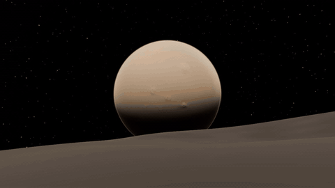
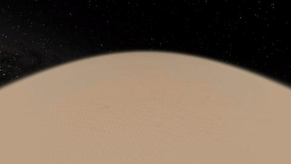
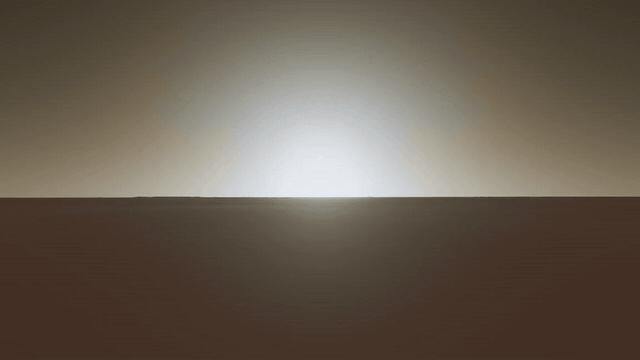
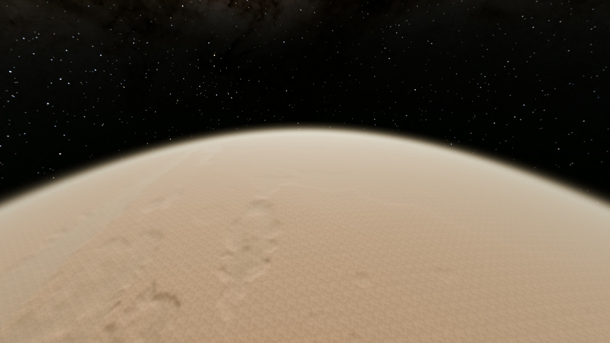
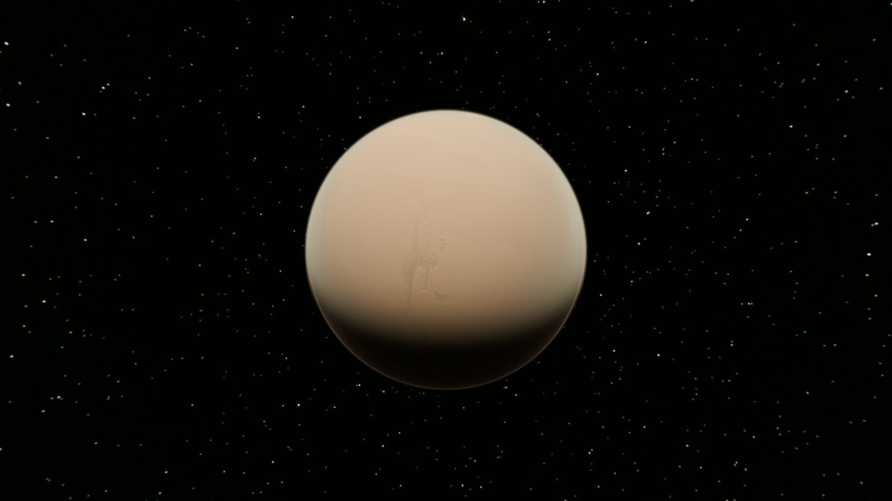
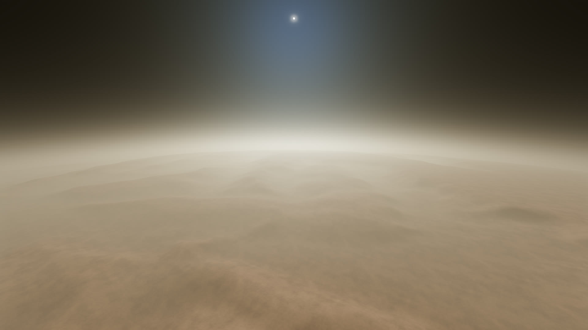
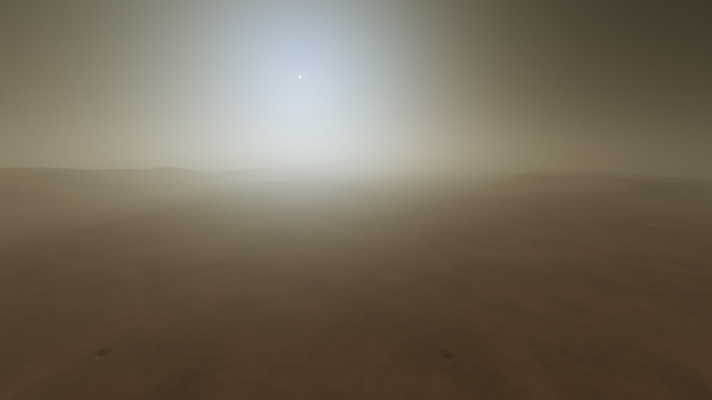
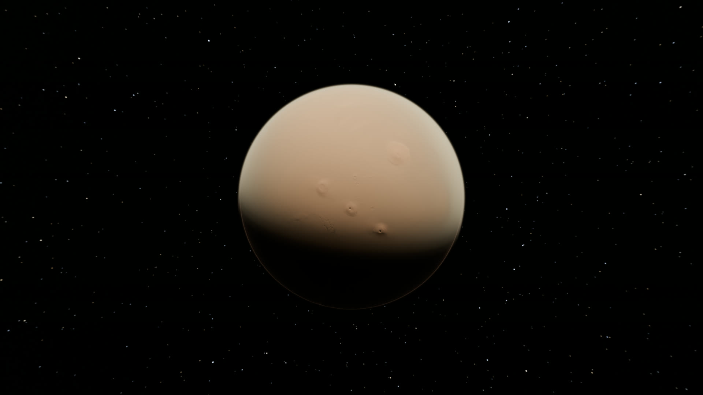
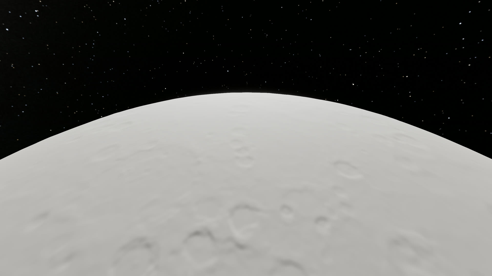

# Regolith

True-scale planets for Godot 4.7, as a C++ GDExtension. Every body is a
cube-sphere displaced by its real elevation data, flown from orbit down to
the ground in one take, under a physically based atmosphere and the real
night sky, with orbital mechanics between the planets.



|  |  |
|---|---|
| 400 km orbit to 3 m over Mars, one take | Mars's blue sunset |

|  |  |  |
|---|---|---|
| 400 km orbit | Mars from 6000 km | 40 km up, through the dust |
|  |  |  |
| Valles Marineris | Mars from Phobos | Mercury from 300 km |

Everything above is the included example, rendered in engine: Mars
(MOLA/HRSC), Mercury (MESSENGER) and Phobos at their real positions.

**Built on Regolith: [MORS](https://store.steampowered.com/app/4950970/MORS/),
a game set on true-scale Mars. If you like what you see, wishlist it on
Steam.**

## Orbital mechanics

`RegolithSystem` flies vessels the way KSP does, at true scale: gravity
from every body and the Sun, patched conics between spheres of influence,
vessels on rails when far away or under time warp (`set_warp`, up to
10,000,000x), and an impact (`vessel_impact`) when a coasting vessel meets
the ground. Plan transfers with `get_body_state_at` (where a body will be)
and fly them with thrust on any `RigidBody3D` carrying a `RegolithVessel`.
A vessel put on rails while at rest against the ground (under 2 m/s) is
landed, pinned to its body, when it is near the terrain or rests on a body
Regolith does not fly (a building, a deck) or on a landed vessel; otherwise
it coasts on its orbit. A `RigidBody3D` reports what it rests on only with
`max_contacts_reported` above 0.

## The engine

Regolith is made for Godot 4.7.2 with a few renderer patches and
double precision. `engine/build_godot.sh` (or `build_godot.ps1` on
Windows) builds that Godot, editor and export templates. On a stock
Godot it still runs, slowly, and warns you. See `engine/README.md`.

## Bodies from DEMs

`tools/make_body.py` turns any global elevation raster GDAL can read
(GeoTIFF, PDS IMG, JPEG 2000 and more) into a body:

```
pip install rasterio numpy
tools/make_body.py Vesta_Dawn_HAMO_DTM_DLR_Global_48ppd.tif --name vesta --out data/packs
```

It takes the radius from the DEM's coordinate system, tells heights
from radii, handles projected or geographic grids and 0..360 or
-180..180 longitudes, warps in chunks (rasters bigger than memory
are fine), and bakes `NAME_height.rgp` down to the level the data
supports. Point a `RegolithBody`'s `pack_path` at it.

Underneath is `regolith_bake dem`, which reads a plain global float32
grid and also takes a datum raster (an areoid or selenoid) for
bodies whose heights are over one. `tools/verify_pack.py dem`
checks a baked pack against its grid independently.

## Sky and atmosphere

`RegolithAtmosphere` draws the sky, the haze and the light as one
physically based model (Hillaire 2020): no sky shader, no painted
colours. Set `air` to a preset (`Mars`, `Earth`, `None` for an
airless body) or to `Custom` and give the air's gas (Rayleigh),
aerosol (Mie) and ozone coefficients per km. From those it
renders, as a compositor pass costing about 0.25 ms:

- the sky from anywhere: the ground, the stratosphere, orbit;
- aerial perspective on all geometry (Godot's fog is switched off);
- the sun's colour and strength through the air, and the ambient
  light from the sky and sunlit ground, set on the scene each frame;
- the night sky: the 9,096 stars of the Yale Bright Star Catalogue
  at their true positions, brightness and colour, and NASA's
  Milky Way, on a dark-adapting eye (`night_vision` caps it).

The sky draws nothing you could fly to: planets and moons are
`RegolithBody` nodes. Mars's dust follows `dust_tau`, which
`RegolithWeather` sets; `dust_scale` (1 by default) is the share
of it the air renders, for a game that wants a clearer or hazier
look than the optical depth its weather reports.

Data: Yale Bright Star Catalogue, 5th ed. (Hoffleit and Warren,
1991). Milky Way: NASA/Goddard Space Flight Center Scientific
Visualization Studio, Deep Star Maps 2020. `tools/make_sky_data.gd`
rebuilds `regolith_stars.res` and `regolith_milkyway.res` from them.

## Weather and clouds

`RegolithWeather` runs a closed-form climate for its body: dust and
regional storms, winds, ground and air temperatures, seasonal caps
and frost, water vapour and cloud. Its seasons and hours come from
the body's own orbit and spin. Everything else is its `config`
dictionary, and every key left out is Mars's:

- the body and its air: `radius`, `gravity`, `sol_s`,
  `obliquity_deg`, `eccentricity`, `perihelion_ls`, `solar_flux`,
  `scale_height`, `datum_pressure`, `r_gas`, `gamma`, and how the
  air cools with height (`lapse_low`, `lapse_high`, `lapse_turn_m`,
  `air_floor_k`);
- the climate model: storm sites and seasons, the winds, the
  temperatures, the cap tables (`cap_north`, `cap_south`) and the
  frost point, the vapour columns, the cloud levels and each cloud
  kind. Every key is a field of `ClimateModel` in
  `core/include/regolith/climate_model.hpp`, with its unit and its
  Mars value.

A key of the wrong shape or out of range is reported and keeps
Mars's value. `RegolithClouds` draws the weather's clouds as
sheets: `sheet_gap`, `sheet_thickness` and `streak` (3 km, 600 m
and 6 for Mars's ice clouds) shape them.

## Example

Open `addons/regolith/example/regolith_example.tscn` and run it:
two planets, Mars (with its air) and Mercury (airless), at their
real positions for today's date, and Phobos as a bonus moon. Fly
with the mouse and WASD (speed follows the height, up to an AU
in seconds between the planets), or jump with 1 to 5. Its packs
are small: the global DEMs to cube level 3, the finer detail
synthesised. Mercury: MESSENGER Global DEM 665 m v2 (USGS
Astrogeology). Mars: MOLA/HRSC blended DEM. Phobos: Gaskell's
shape model. Cut a big pack down the same way with
`regolith_bake slice --in A.rgp --out B.rgp --max-level 3`.

Any number of planets can share one `RegolithSystem`: the body
without an orbit table named by `body` is the centre, and every
other such body sits at its own orbit round the sun (its
`preset`). The sun's direction and brightness follow the camera.

## Terrain surfaces

What the ground looks like is a *surface*: one `.gdshaderinc` set
on a `RegolithBody`'s `surface_path`. Regolith inlines it into its
terrain core (geometry, heights, terrain shadows, the sun and sky
per point), so a surface only decides the material. Leave
`surface_path` empty for `regolith_surface_default.gdshaderinc`:
procedural, no textures, ground coloured by height with rock on
slopes, all of it tunable from its uniforms.

A surface declares any uniforms it wants and one function:

```glsl
uniform vec3 sand : source_color = vec3(0.6, 0.4, 0.3);

void surface(TerrainPoint p, inout TerrainSurface s) {
	s.albedo = mix(sand, vec3(0.3), smoothstep(0.1, 0.3, p.slope));
	s.roughness = 0.9;
}
```

`TerrainPoint p` gives, per pixel: `normal`, `up` (model space),
`slope` (1 - cos, 0 level), `height` (m over the reference radius),
`body_dir` (body-fixed unit vector: latitude `asin(z)`, longitude
`atan(y, x)`), `local` (face metres, precise near the camera),
`noise_m` (metres wrapping every 20 km, for tiling noise), `dd`
(screen gradients of `local`, for `textureGrad`), `geology`,
`axis_x` / `axis_y` (tangents), `eye_height` and `ring`.

`TerrainSurface s` starts at sensible defaults; set any of
`albedo`, `roughness`, `specular`, `normal` (model space),
`normal_map` with `normal_map_depth` (tangent space along
`axis_x` / `axis_y`), `ao`, `ao_light_affect` and `emission`.

**Legacy path:** `clip_quads = 0` selects the old per-tile CDLOD
terrain (`regolith_terrain.gdshader`). It carries MORS's fixed Mars
ground material, ignores `surface_path` and the per-point air light,
and is kept for reference only, unmaintained; Regolith warns when a
body uses it. Leave `clip_quads` at its default (256).

For textures that tile exactly at planet scale, the core offers
precise per-ring domains: `domain(id)` and `domain_scale(id)`.
Set a surface's uniforms from code with
`RegolithBody.set_material_param(name, value)`. The surface works
on stock Godot too: Regolith fits the combined shader to the engine.

## Bodies

Each `RegolithBody` takes a `preset` (Mercury to Neptune, the Moon,
Phobos, Deimos, Vesta, Ceres) filling its rotation, orbit and
gravity, all of which can then be set by hand.

## Layout

- `core/`: maths, projection, tile keys, frames. No Godot dependency;
  shared by the extension and the baker.
- `gdext/`: the Godot extension.
- `tests/`: core unit tests.
- `addon/`: the `.gdextension` file, copied next to the built library.
- `thirdparty/godot-cpp/`: submodule, pinned to `10.0.0-stable` (Godot
  4.7 API).

## Build (Linux)

```
git submodule update --init
cmake -S . -B build -G Ninja -DCMAKE_BUILD_TYPE=Release
cmake --build build -j 16
./build/regolith_core_tests
```

The built addon lands in `dist/addons/regolith/`, or in
`../addons/regolith/` when Regolith sits in a game as a submodule
(override with `-DREGOLITH_ADDON_DIR=...`). `tools/build_all.sh`
builds all eight libraries; `tools/package_release.sh VERSION`
then makes the release downloads in `release/`.

## Installing a release

No compiling needed. From a release, take:

- `regolith-VERSION-addon.zip`: unzip into your project, giving
  `addons/regolith/` (all eight libraries, the example included).
- `godot-4.7.2.stable.double-regolith-linux-editor.zip` or
  `...-windows-editor.zip`: the patched double-precision Godot
  editor. Open your project with it.
- `godot-4.7.2.stable.double-regolith-export-templates.tpz`: in
  that editor, Editor > Manage Export Templates > Install from File.

Godot's own licence (MIT) is in the editor downloads.

## Exporting

Build every library first: `tools/build_all.sh` makes Linux and
Windows, debug (editor) and release (exports), double and single
(Windows cross-compiles with MinGW-w64; set `ZSTD_SRC` to a zstd
`lib/` tree, Godot's `thirdparty/zstd` will do). Export with the
double-precision templates `engine/build_godot` builds.

Regolith reads its packs (`.rgp`, `.rge`) and maps with plain file
calls. Add them to the export (`include_filter`, e.g.
`addons/regolith/example/data/*`): at first launch Regolith copies
each one out of the `.pck` into `user://regolith_data/`, once. For
multi-gigabyte packs, ship them as loose files beside the
executable, at the same relative path (`res://data/x.rgp` as
`data/x.rgp`): Regolith uses those directly, with no copy.

## License

Copyright (c) 2026 PhialsBasement. Regolith is licensed under the
[Mozilla Public License 2.0](LICENSE).

In short: use it in any project, free or commercial, open or closed,
at no cost. Your own code, scenes and assets stay yours, under any
licence you choose. If you ship changes to Regolith's own files,
those changed files stay under the MPL and their source must be
available, with the licence and copyright notices kept. The
`LICENSE` file is the binding text; this summary is not.

Third-party parts keep their own licences: godot-cpp (MIT),
FastNoiseLite (MIT), and the data credited above (NASA, USGS and
ESA planetary data, the Yale Bright Star Catalogue).
